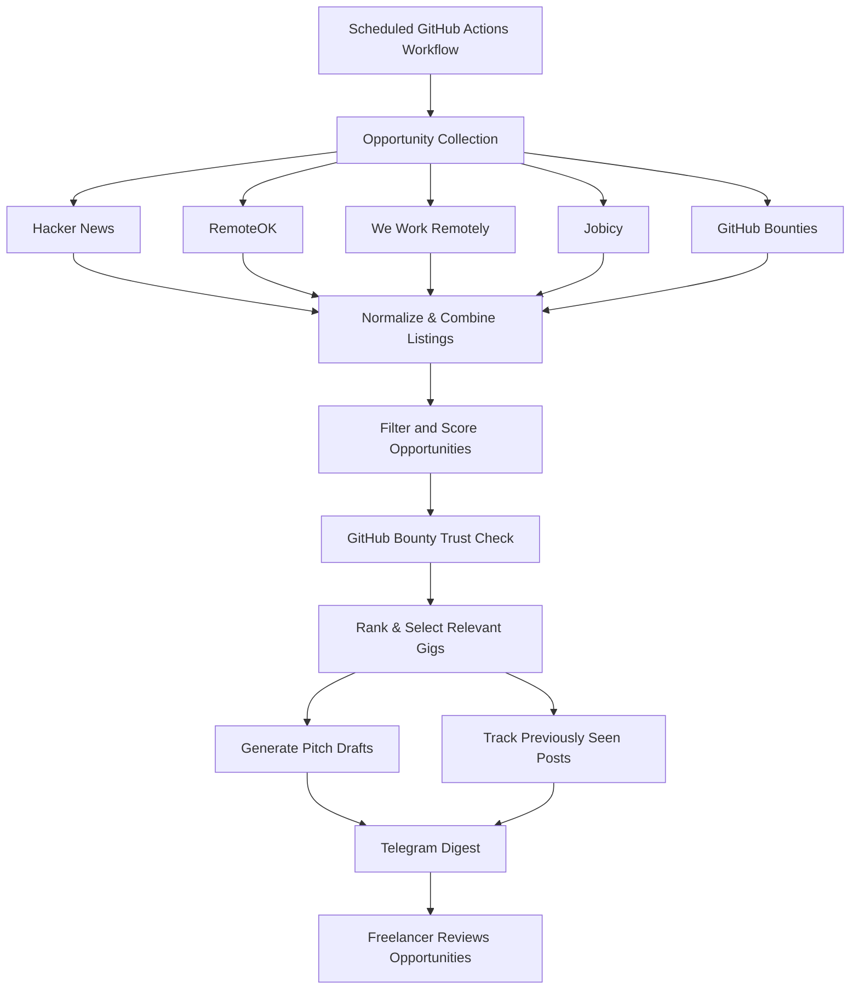

# 📡 GigRadar

<p align="center">
  
  
  
  
  
</p>

<p align="center">
  <strong>Find better freelance opportunities. Filter the noise. Respond faster.</strong>
</p>

<p align="center">
  An automated freelance opportunity discovery and qualification system that collects gigs from multiple sources, ranks potential matches, generates AI-assisted pitch drafts, and delivers curated opportunities directly to Telegram.
</p>

<p align="center">
  <a href="#-overview">Overview</a> •
  <a href="#-features">Features</a> •
  <a href="#-how-it-works">Architecture</a> •
  <a href="#-technology-stack">Tech Stack</a> •
  <a href="#-setup-and-configuration">Setup</a> •
  <a href="#-project-structure">Structure</a>
</p>

---

## 🎯 Overview

Finding freelance work often means repeatedly searching multiple platforms, filtering irrelevant listings, checking whether an opportunity is genuinely paid, and writing a personalized pitch for every potential client.

**GigRadar automates much of this discovery and preparation process.**

It collects freelance opportunities from multiple public sources, evaluates them using configurable scoring rules, identifies selected warning signals in GitHub bounty listings, and delivers a ranked digest to Telegram.

For promising opportunities, GigRadar can also generate an opening pitch using the Anthropic API.

The system is designed to help freelancers spend less time searching and more time evaluating and pursuing relevant work.

> **Important:** GigRadar is an opportunity discovery and assistance tool. It does not automatically apply for jobs, contact clients, or guarantee that a listing is legitimate.

## ✨ Features

### 🔎 Multi-source opportunity discovery

Collects opportunities from:

- Hacker News — monthly freelance discussion thread.
- RemoteOK — remote work listings.
- We Work Remotely — remote job listings.
- Jobicy — remote job listings with job-type information.
- GitHub — issues carrying bounty-related labels.

Each source is handled independently, allowing the collection pipeline to be extended with additional sources.

### 🎯 Rule-based filtering and ranking

Not every job listing is a suitable freelance opportunity.

GigRadar evaluates listings using configurable signals:

| Signal | Filtering behavior |
|---|---|
| Payment indicators | Rewards listings mentioning budgets, payment, or currency amounts |
| Task specificity | Recognizes signals such as bug fixes, scripts, integrations, and automation |
| Employment indicators | Penalizes full-time roles, internships, and permanent positions |
| Scope indicators | Penalizes vague or excessively large project descriptions |
| Competition | Uses comment count as a simple early-response signal |
| Source type | Applies source-specific score adjustments |
| Job type | Uses explicit freelance/contract information when available |

The scoring system ranks opportunities and returns a configurable number of higher-scoring results.

### 🛡️ GitHub bounty trust signals

GitHub bounty listings receive an additional heuristic check.

GigRadar examines:

- The age of the GitHub issue author's account.
- The age of the repository associated with the bounty.

Accounts and repositories that are both very new (seven days or less) are flagged for additional caution.

**This is a warning heuristic, not a fraud-detection system.** Account age alone cannot establish whether a bounty is legitimate. GigRadar cannot independently verify payment intent, escrow availability, or the reputation of the person offering the work.

### 🤖 AI-assisted pitch generation

For promising opportunities, GigRadar can use the Anthropic API to generate an opening pitch.

- Produces an initial response tailored to the opportunity.
- Helps reduce repetitive pitch-writing work.
- Supports a template-based fallback when an API key is unavailable.

Generated pitches are drafts. Review and personalize them before sending.

### 📲 Telegram opportunity digest

GigRadar delivers curated results directly to Telegram.

- Scheduled opportunity digests.
- Links to original listings.
- Ranked opportunities.
- Pitch drafts.
- A convenient review process from your phone.

No client outreach is performed automatically. You remain in control of every application and message.

### ⚙️ Automated execution

GitHub Actions runs the collection pipeline on a scheduled basis.

- Runs twice daily.
- Does not require a continuously running personal computer.
- Supports manual execution through the GitHub Actions interface.
- Uses GitHub repository secrets for API credentials.

---

## 🔄 How It Works

GigRadar follows a modular pipeline:



### Pipeline explanation

| Stage | Component | Responsibility |
|---|---|---|
| 1 | GitHub Actions | Starts the workflow on schedule or manual trigger |
| 2 | `scraper.py` | Collects opportunities from configured sources |
| 3 | `filter.py` | Evaluates, scores, and ranks listings |
| 4 | `trust_check.py` | Checks selected GitHub bounty trust signals |
| 5 | `state.py` | Maintains previously seen opportunity state |
| 6 | `pitch.py` | Generates opening pitch drafts |
| 7 | `notifier.py` | Formats and delivers the Telegram digest |
| 8 | `main.py` | Coordinates the complete execution pipeline |

---

## 🧰 Technology Stack

<p align="center">
  
</p>

| Technology | Purpose |
|---|---|
| Python | Core application and automation logic |
| GitHub Actions | Scheduled execution and workflow automation |
| Telegram Bot API | Opportunity notifications and digests |
| Anthropic API | Optional AI-assisted pitch generation |
| GitHub API | GitHub bounty discovery and account/repository information |
| HTTP requests and parsing | Collecting information from external sources |
| JSON | Opportunity data and previously seen state |
| Regex | Rule-based opportunity scoring and filtering |

---

## 📁 Project Structure

```text
GigRadar/
│
├── .github/
│   └── workflows/
│       └── digest.yml       # Scheduled GitHub Actions workflow
│
├── scraper.py               # Multi-source opportunity collection
├── filter.py                # Scoring, filtering and ranking
├── trust_check.py            # GitHub bounty trust heuristics
├── pitch.py                  # AI-assisted pitch generation
├── notifier.py               # Telegram digest delivery
├── state.py                  # Previously seen opportunity tracking
├── main.py                   # Pipeline orchestration
│
├── seen_posts.json           # Stored opportunity state
├── requirements.txt          # Python dependencies
└── README.md
```

---

## 🚀 Setup and Configuration

You can run GigRadar locally or configure it to run automatically through GitHub Actions.

### 1. Clone the repository

```bash
git clone https://github.com/UjjawalKr-01/GigRadar.git
cd GigRadar
```

### 2. Install dependencies

Create and activate a virtual environment:

```bash
python -m venv venv
```

On Windows:

```powershell
.\venv\Scripts\Activate.ps1
```

On Linux/macOS:

```bash
source venv/bin/activate
```

Install the required packages:

```bash
pip install -r requirements.txt
```

### 3. Configure Telegram

GigRadar uses a Telegram bot to deliver opportunity digests.

1. Open Telegram and search for [@BotFather](https://t.me/BotFather).
2. Create a bot using `/newbot`.
3. Follow the instructions and copy the bot token.
4. Start a conversation with your new bot.
5. Retrieve your Telegram chat ID using the Telegram Bot API `getUpdates` endpoint.

Keep your bot token private.

### 4. Configure Anthropic API (Optional)

An Anthropic API key enables AI-assisted pitch generation.

Get an API key from the [Anthropic Console](https://console.anthropic.com/).

Without this key, GigRadar can use its template-based pitch fallback.

### 5. Configure environment variables

GigRadar requires the following environment variables:

| Variable | Required | Purpose |
|---|---|---|
| `TELEGRAM_BOT_TOKEN` | Yes | Telegram bot authentication |
| `TELEGRAM_CHAT_ID` | Yes | Destination for notifications |
| `ANTHROPIC_API_KEY` | No | AI-assisted pitch generation |

Never hardcode API keys or bot credentials in source files.

### 6. Run locally

On Windows PowerShell:

```powershell
$env:TELEGRAM_BOT_TOKEN="your_bot_token"
$env:TELEGRAM_CHAT_ID="your_chat_id"
$env:ANTHROPIC_API_KEY="your_anthropic_key"

python main.py
```

On Linux/macOS:

```bash
export TELEGRAM_BOT_TOKEN="your_bot_token"
export TELEGRAM_CHAT_ID="your_chat_id"
export ANTHROPIC_API_KEY="your_anthropic_key"

python main.py
```

The Anthropic API key can be omitted if you want to use the fallback pitch template.

---

## ⏰ Automated Execution with GitHub Actions

GigRadar uses GitHub Actions to execute the opportunity discovery pipeline automatically.

The configured workflow runs twice daily:

| Schedule | UTC time |
|---|---|
| Morning run | 08:00 UTC |
| Evening run | 18:00 UTC |

### Configure GitHub repository secrets

Navigate to:

**Repository → Settings → Secrets and variables → Actions → New repository secret**

Add:

```text
TELEGRAM_BOT_TOKEN
TELEGRAM_CHAT_ID
ANTHROPIC_API_KEY
```

The Anthropic key is optional.

### Trigger manually

1. Open the repository's **Actions** tab.
2. Select **GigRadar Digest**.
3. Select **Run workflow**.
4. Wait for the workflow to complete.
5. Check your Telegram chat for the digest.

The scheduled workflow uses GitHub Actions runners, so your local machine does not need to remain switched on.

---

## 🎛️ Customization

GigRadar is designed to be configurable.

### Adjust filtering strictness

Modify the `min_score` and `top_n` arguments in the `filter_and_rank()` call in `main.py`.

- `min_score` controls the minimum score required for an opportunity to be included.
- `top_n` controls how many ranked opportunities are selected.

### Modify scoring rules

Edit `filter.py` to adjust:

- Positive keyword signals.
- Negative keyword signals.
- Payment indicators.
- Source-specific score adjustments.
- Job-type adjustments.
- Competition-related scoring.
- Exclusion patterns.

### Add new opportunity sources

Each source has its own collection function in `scraper.py`.

To add a source:

1. Implement its collection function.
2. Normalize its output to the common opportunity structure.
3. Register it in `get_all_posts()`.
4. Test the returned data and filtering behavior.

### Change the execution schedule

Edit the cron expression in:

```text
.github/workflows/digest.yml
```

Remember that GitHub Actions cron schedules use UTC.

---

## ⚠️ Limitations and Responsible Use

GigRadar is an automated discovery assistant, not a guarantee of freelance income or opportunity legitimacy.

- Public sources can change their page structure, APIs, access rules, or rate limits.
- Some listings may be irrelevant or incorrectly ranked.
- Keyword-based scoring is heuristic and may produce false positives or false negatives.
- GitHub account/repository age is not proof of fraud.
- A listing that passes the trust check is not necessarily legitimate.
- Payment arrangements, escrow, client reputation, and project requirements must be checked independently.
- AI-generated pitches require human review.
- Reddit was removed as a source because its public JSON endpoint was unreliable from cloud/CI environments.

Always review an opportunity and its payment terms before committing time or sharing sensitive information.

---

## 🗺️ Future Improvements

Potential directions for extending GigRadar:

- More freelance marketplaces and opportunity sources.
- Improved duplicate detection and opportunity normalization.
- Freelancer-specific skill and technology matching.
- Configurable scoring profiles.
- Better competition and freshness analysis.
- More detailed opportunity analytics.
- Improved pitch personalization.
- Persistent structured storage instead of a local JSON state file.
- Automated tests for scraping and filtering components.
- Better observability and failure reporting.

These are potential development directions, not claims about existing functionality.

---

## 💡 Project Philosophy

GigRadar is built around a simple idea:

**Finding freelance work should involve less repetitive searching and more informed decision-making.**

Rather than automatically applying to every available listing, the system focuses on discovering opportunities, reducing irrelevant results, identifying warning signals, and preparing useful first drafts.

The final decision always stays with the freelancer.

---

<p align="center">
  <strong>Discover opportunities. Filter intelligently. Pitch confidently.</strong>
</p>

<p align="center">
  Built with Python, automation, and a little ambition by <a href="https://github.com/UjjawalKr-01">Ujjawal Kumar</a>.
</p>
